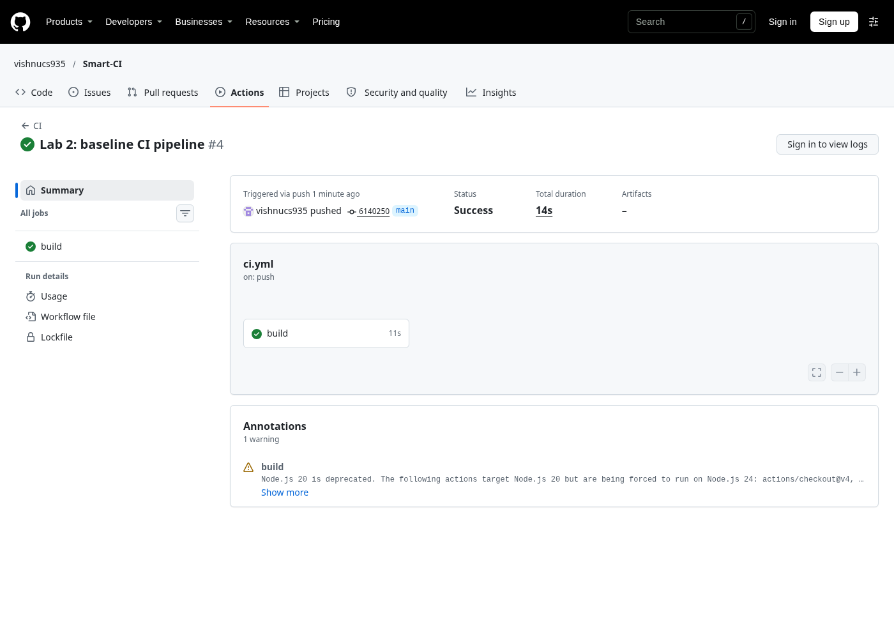
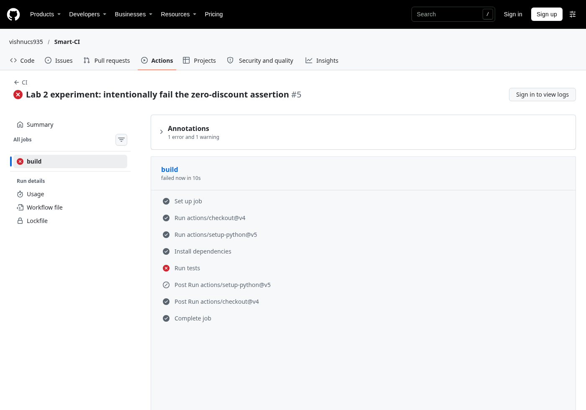

# Smart-CI · Assignment 4, Part 1

Labs 0–2 build a small Python shopping cart and use GitHub Actions to test every push and pull request.

## Lab 0 · Setup

Open this repository in VS Code with Python 3.12 and Git installed. Install the Python and GitHub Copilot extensions and sign in to Copilot with your own account. From the project root:

```sh
python -m venv .venv
source .venv/bin/activate
python -m pip install -r requirements.txt
pytest -v
```

On Windows Command Prompt, activate the environment with `.venv\Scripts\activate.bat`. In VS Code, choose **Python: Select Interpreter** and select the interpreter inside `.venv`. The assignment reserves `scripts/`, `ml/`, `infra/`, and `ansible/` for later labs.

## Lab 1 · Application and tests

- **Pricing** applies discounts from 0% through 100%, rejects out-of-range percentages, and rounds the result to two decimal places. The default tax rate is 18%.
- **Cart** imports the pricing functions. Two pens at 50 each give a subtotal of 100. A 10% discount reduces it to 90, and tax brings the total to 106.20.
- **Inventory** accumulates stock, subtracts quantities, and raises an error if a removal would exceed available stock.

All 10 pytest cases passed locally under Python 3.12. The suite covers discount boundaries, invalid percentages, tax, cart totals, an empty cart, and inventory updates. [Lab 1 checkpoint](../../tree/lab1)

## Lab 2 · Baseline CI

| Workflow setting or step | Purpose |
|---|---|
| `name: CI`, `on: [push, pull_request]` | Labels the workflow and triggers it on pushes and pull requests. |
| `permissions: contents: read` | Gives the job read access to repository contents. |
| `jobs.build.runs-on: ubuntu-latest` | Starts the build job on a fresh Ubuntu runner. |
| `actions/checkout@v4`, `fetch-depth: 0` | Checks out the project and downloads full history for later change comparisons. |
| `actions/setup-python@v5` | Selects Python 3.12 on the runner. |
| `pip install -r requirements.txt` | Installs pytest and requests. |
| `pytest 2>&1 \| tee build.log` | Combines standard output and error, displays both, and writes a copy to the runner's build.log. |
| `set -o pipefail` | Makes a pytest failure fail the step even when tee succeeds. |

### Baseline measurement

The initial green run took **14 seconds** overall. The build job took **11 seconds**, including **4 seconds** for **Install dependencies** (11:09:42–11:09:46 UTC). These measurements come from run #4. [Baseline run](https://github.com/vishnucs935/Smart-CI/actions/runs/45601800483)



### Red-run experiment

In `tests/test_pricing.py`, the expected result of applying a 0% discount to 100 was deliberately changed from 100.0 to 101.0. The application correctly returned 100.0. The red run demonstrates that CI detects a disagreement between the code and its test. Here the test expectation needed correction.

**Where to find the error:** Open **Actions → CI → run #5 → build → Run tests**. Expand that step and search for `test_discount_boundaries`. GitHub may ask you to sign in to expand the log. [Failed job and test step](https://github.com/vishnucs935/Smart-CI/actions/runs/45601805118/job/139162344571#step:5:1)

```text
>       assert apply_discount(100, 0) == 101.0
E       assert 100.0 == 101.0
FAILED tests/test_pricing.py::test_discount_boundaries - assert 100.0 == 101.0
1 failed, 9 passed in 0.04s
```



### Repair and verification

Restoring the expected value to 100.0 made all 10 tests pass again. Run #6 took **18 seconds** overall, including **4 seconds** for dependency installation. [Repaired run](https://github.com/vishnucs935/Smart-CI/actions/runs/45601891987)


